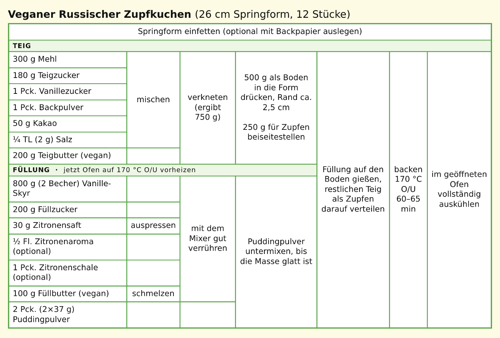

# Recipe

"A recipe says what goes in, and where each thing goes."

Not a use case: the shape of a recipe's content and the rules it must satisfy. Adding ([adding-recipes.md](adding-recipes.md), rule 1) and revising ([revising-recipes.md](revising-recipes.md), rule 1) check them.

Running example: Veganer Russischer Zupfkuchen (26 cm Springform, 12 Stück), from the "Zupfkuchen-Ablauf" table.

## Data

The content of one revision. Source, photo, tags, and revisions sit beside it.

**Recipe**

| Field | Type | Content |
|---|---|---|
| title | text | "Veganer Russischer Zupfkuchen" |
| yield | amount, optionally a vessel from the equipment | 12 Stück, Springform 26 cm |
| sections | names | "Teig", "Füllung" |
| items | list | Zucker, vegane Butter, Mehl |
| ingredients | list, each optionally in a section | at least one |
| equipment | list | Springform 26 cm, Ofen, Mixer |
| steps | list, in the author's order | at least one |

**Item**: what you buy. Listed once per recipe, under a name unique in the recipe (ignoring case). An item exists while an ingredient refers to it.

| Field | Type | Content |
|---|---|---|
| name | text | Zucker |

**Ingredient**: one line of the ingredient list. The same item can appear in several ingredients.

| Field | Type | Content |
|---|---|---|
| item | one of the recipe's items | Zucker |
| amount | number or range, a unit, optionally a second amount; or none | 180 g · 1–2 Zehen · ¼ TL (2 g) |
| section | one of the recipe's sections, optional | Teig |
| note | text, optional | vegan · nach Geschmack |
| prep | one verb, optional | auspressen · schmelzen |
| optional | yes / no | ½ Fl. Zitronenaroma |

The Zupfkuchen has the item Zucker in two ingredients: 180 g in Teig, 200 g in Füllung.

**Step**

| Field | Type | Content |
|---|---|---|
| label | short text, for the table | "verkneten" |
| sentence | text, optional | "Die Mischung mit der Butter zu einem glatten Teig verkneten." |
| section | one of the recipe's sections, optional | Teig |
| equipment | from the recipe's equipment | Mixer |
| duration | minutes or a range of minutes; active or passive | 60–65 min, passive |
| temperature | °C, with a heating mode | 170 °C Ober-/Unterhitze |
| uses | ingredients, optional | 200 g vegane Butter (Teig) |
| result | optional: a name and amount, or a split into portions | Teig (750 g) → 500 g Boden, 250 g Zupfteig |
| takes | results and portions, optional; replaces the derived ones (rule 11) | Boden |
| waits for | steps, optional; replaces the derived ones (rule 11) | — |

## Rules

### Content

1. **Title, ingredient, step.** A recipe has a title, at least one ingredient, and at least one step.
2. **Amounts as written.** An amount is a number ("300 g") or a range ("1–2 Zehen"), and may carry a second amount ("¼ TL (2 g) Salz"). Its unit comes from a fixed list (g, kg, ml, l, TL, EL, cup, oz, Pck., Becher, Zehe, Prise, …) or is the author's own word ("Messerspitze"); a count has none ("2 Eier"). No amount at all is fine: "Salz, nach Geschmack" puts the words in the note. Amounts are kept in the author's units; showing them in other units is a view ([cooking.md](cooking.md), rule 8). Forcing one number or one unit loses information.
3. **Ingredients refer to items.** Each ingredient refers to one of the recipe's items, and several may refer to the same one: 180 g Zucker in Teig and 200 g Zucker in Füllung. Cooks weigh out per section, so the list keeps them apart; totals per item ("380 g Zucker") are derived ([cooking.md](cooking.md), rule 3). An item's name is unique in the recipe, ignoring case; an item with no ingredient left is gone.
4. **Optional ingredients.** An ingredient may be optional. The recipe works without it.
5. **Prep on the ingredient.** An ingredient may name one prep: something done to it alone before it goes into its step ("Zitronensaft: auspressen", "Butter: schmelzen"). Recipes write it on the ingredient ("100 g Butter, geschmolzen"). As steps, these would sit side by side and break the chain of rule 11.
6. **Sections.** Ingredients and steps may be grouped into sections ("Teig", "Füllung").
7. **Step details.** A step may name equipment, a duration, and a temperature with a heating mode. A duration is minutes or a range of minutes, active or passive; a step with no clear length ("vollständig auskühlen", "über Nacht") has none, and its sentence says it. Cook mode starts timers from durations and reminds about preheating ([cooking.md](cooking.md), rule 5).
8. **Label and sentence.** A step has a short label and may have a full sentence. Without one, the sentence is built from the label and what the step uses and takes.
9. **Yield.** The yield is an amount ("12 Stück") and may name the vessel from the equipment ("Springform 26 cm"). Scaling to another vessel builds on it ([later.md](later.md)).

### Steps and flow

10. **Steps, with or without ingredients.** Every recipe has steps, in the author's order. A step may name the ingredients it uses. Either no step does (plain steps, how most recipes are written) or every ingredient is used by exactly one step (rule 14), and the recipe has a flow. Plain steps are a usable recipe; the table and cook mode's per-step ingredients need a flow.
11. **The flow is derived.** What each step takes and waits for follows from the steps' ingredients, sections, equipment, and order:
    - **Chain.** A step takes the result of the nearest earlier step in its section that makes something. Steps without a section count as one section.
    - **Join.** A step without a section also takes the latest result of each section whose steps came since the previous step without a section, and every portion no step has taken yet.
    - **Prep steps.** A step that uses and takes nothing makes nothing ("vorheizen", "Springform einfetten"). The next step with the same equipment waits for it.

    A step that names what it takes or waits for replaces what's derived. That's needed for splits (rule 16) and for parallel parts without sections. The author writes steps as recipes are written, and the app editor needs no flow editor: ticking each step's ingredients is enough.

### Flow

Checked on the derived flow, with what steps name themselves.

12. **Everything named exists.** What a step uses, takes, or waits for exists in the recipe.
13. **No loops.** No step takes or waits for its own result, directly or through other steps.
14. **Every ingredient goes to one step.** Each ingredient is used by exactly one step. An item used in two steps is two ingredients: "¼ TL Salz" in Teig and "¼ TL Salz" in Füllung. A forgotten ingredient is the most common recipe mistake, and the table would show a row that leads nowhere.
15. **A result goes to one place.** A step's result is taken by at most one other step. To use it in two places, split it into portions. The table and cook mode must know where each thing goes.
16. **Portions.** A split names each portion. Each has an amount, except at most one that is "the rest" ("500 g als Boden, den Rest für Zupfen"). If the result has an amount, the portions' amounts don't exceed it. Every portion is taken by a later step; an unused portion means a missing step.
17. **Waiting.** A step may wait for another without taking its result: "backen" waits for the preheated oven, pressing the base waits for the greased form.
18. **What the recipe makes.** A result nobody takes or waits for is what the recipe makes; a flow has at least one. Prep steps make nothing (rule 11).
19. **The author's order.** Each step comes after every step it takes from or waits for. Derived links always point back; a step that names a later one is refused. Parallel parts (Teig, Füllung) have no order of their own, and timing is the author's call: "jetzt Ofen vorheizen" goes at the start of the Füllung.

### Keys

20. **Keys.** Every section, ingredient, step, equipment, and portion has a key, unique in the recipe and kept across revisions: `zucker-teig`, `verkneten`, `zupfteig`. The author picks it when adding the thing. Edits and steps point at keys ([revising-recipes.md](revising-recipes.md), rule 1); names can repeat and positions shift. Items are pointed at by name (rule 3).

## Examples

| Zupfkuchen, unless named | Result |
|---|---|
| as in the image: steps name their ingredients; `verkneten` splits into Boden (500 g) and Zupfteig (250 g); `boden` takes Boden | valid flow; everything else derived (rule 11) |
| Zitronensaft with prep "auspressen", Füllbutter with "schmelzen"; `verrühren` uses both | `verrühren` is the first step in Füllung that makes something (rules 5, 11) |
| the same with "auspressen" and "schmelzen" as steps in Füllung | "schmelzen" takes the squeezed juice (rule 11, chain); prep them on the ingredients instead |
| `gießen` without a section, after Teig and Füllung | takes Boden, the Füllung, and the untaken Zupfteig (rule 11, join) |
| `vorheizen` (Ofen) first in Füllung, `backen` (Ofen) later | `backen` waits for `vorheizen` (rules 11, 17) |
| Zucker in Teig (180 g) and Füllung (200 g) | two ingredients of the item Zucker, each used once (rules 3, 14) |
| no step uses Kakao | refused (rule 14) |
| `mischen` and `verrühren` both use the 180 g Zucker | refused, add a second ingredient (rule 14) |
| `mischen` names `verkneten` as what it takes | refused (rules 13, 19) |
| "vorheizen" waits for "backen", "backen" for "vorheizen" | refused (rule 13) |
| two steps name the whole Teig as what they take | refused, split it (rule 15) |
| "500 g als Boden, den Rest für Zupfen" | valid (rule 16) |
| "500 g als Boden, 300 g für Zupfen" from 750 g Teig | refused (rule 16) |
| split, but no later step takes Zupfteig and no join follows | refused (rule 16) |
| Pasta from a blog: 6 numbered instructions, no ingredients named | valid plain steps (rule 10) |
| Pasta, ingredients named: water, pasta, "meanwhile" sauce, no sections | derived: the sauce takes the pasta. Put the sauce in its own section, or let it name what it takes (rule 11) |
| Pasta, 5 of 6 ingredients named in steps | refused, Parmesan is used by no step (rule 14) |
| two ingredients with the key `zucker` | refused (rule 20) |
